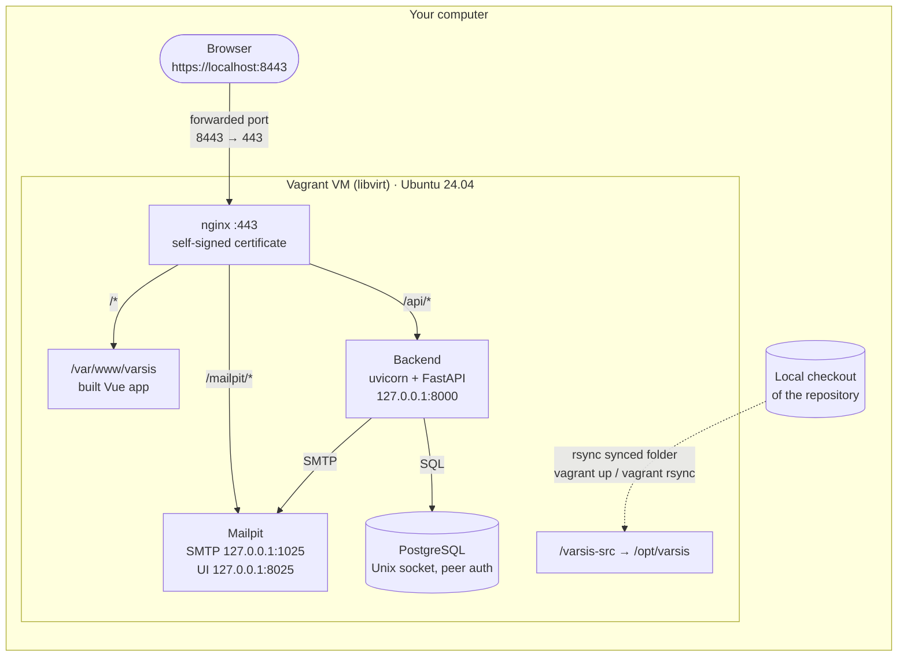

# Varsis with Vagrant (development)

A development VM with the whole stack, created and provisioned by Vagrant from [`Vagrantfile`](Vagrantfile) and the
scripts in [`scripts/`](scripts). Unlike the cloud-init version (which clones the app from GitHub), this one runs
**the code in your local checkout**: edit, then `vagrant rsync && vagrant provision`.

**Development only:** self-signed certificate, Mailpit instead of a mail provider, reachable only from this computer.
The production deployment is the [cloud-init version](../cloud-init).



| Component | Installed from | Role |
|---|---|---|
| nginx | Ubuntu apt | HTTPS (self-signed), static frontend, reverse proxy to the backend and Mailpit |
| Backend (FastAPI on uvicorn, Python 3.13) | deadsnakes PPA (apt), packages from `uv.lock` | REST API |
| PostgreSQL 16 | Ubuntu apt | Database, peer authentication over the Unix socket |
| Frontend (Vue) | built with Node.js 24 from NodeSource's apt repository | Static files served by nginx |
| Mailpit | pinned GitHub release, SHA-256 checked | Catches every mail the app sends |
| ufw | Ubuntu apt | Firewall: only 22 and 443 |

## Requirements

Vagrant with the **libvirt** provider (QEMU/KVM):

```bash
# Arch / CachyOS
paru -S vagrant
sudo pacman -S --needed libvirt qemu-base dnsmasq
# Ubuntu / Debian
sudo apt install vagrant vagrant-libvirt libvirt-daemon-system qemu-kvm

sudo systemctl enable --now libvirtd
sudo usermod -aG libvirt $USER                # then log out and back in
vagrant plugin install vagrant-libvirt        # Arch only (Ubuntu's apt package already includes it)
```

Why libvirt and not VirtualBox: libvirt uses KVM, the hypervisor built into Linux, so it runs next to other KVM VMs
(e.g. Incus). VirtualBox can't run while KVM is in use.

## Run

```bash
cd deploy/vagrant
ADMIN_EMAILS=you@example.com vagrant up      # first time ~3-5 min (downloads the box, installs everything)
```

| | |
|---|---|
| App | https://localhost:8443 (accept the certificate warning) |
| Sent mails | https://localhost:8443/mailpit/ |
| Shell in the VM | `vagrant ssh` |

Register with the address in `ADMIN_EMAILS`, open the verification mail in Mailpit, click the link: the account is an
admin and approved.

## Everyday commands

| Command | What it does |
|---|---|
| `vagrant up` | Create and provision the VM (first time), or start it |
| `vagrant rsync && vagrant provision` | Copy your changed code into the VM and redeploy it |
| `vagrant ssh` | Shell in the VM |
| `vagrant halt` | Shut the VM down |
| `vagrant destroy -f` | Delete the VM (the next `vagrant up` starts from scratch) |
| `vagrant status` | Is it running? |

Logs (inside `vagrant ssh`):

```bash
sudo journalctl -u varsis-backend -f            # backend
sudo tail -f /var/log/nginx/varsis-access.log   # requests
systemctl status varsis-backend nginx postgresql mailpit
```

## How it works

### Vagrantfile

| Setting | Why |
|---|---|
| `config.vm.box = "cloud-image/ubuntu-24.04"` | Ubuntu 24.04 from Ubuntu's official cloud images, published for libvirt (`bento/ubuntu-24.04` has no libvirt version) |
| `forwarded_port 443 → 8443, host_ip 127.0.0.1` | The app is reachable at `https://localhost:8443`, from this computer only |
| `synced_folder ".", "/vagrant", type: "rsync"` | The scripts and config files, copied into the VM |
| `synced_folder "../..", "/varsis-src", type: "rsync"` | The app's code (the repository root), without `.git`, `.env`, build output and dependencies |
| `provider "libvirt"`: 2 CPUs, 2 GB, 20 GB disk | The frontend build needs the memory |
| `provision "shell"` with `env: ADMIN_EMAILS` | Runs the scripts below in order, as root; passes the admin address from your shell |

Synced folders use **rsync** (a one-way copy at `up`/`reload`/`rsync`) rather than libvirt's default **NFS**, which
needs an NFS server and root on the host.

### Provisioning scripts (in order)

| Script | What it does |
|---|---|
| `install-dependencies.sh` | Adds the deadsnakes PPA and NodeSource's apt repository (key pinned with `signed-by`); installs nginx, ssl-cert, PostgreSQL, Python 3.13, pipx, Node.js, rsync, ufw; installs `uv` (pinned version) |
| `create-users-and-folders.sh` | System user `varsis` (no shell); `/opt/varsis` (code, owned by root), `/etc/varsis` (settings, root writes / varsis reads), `/var/lib/varsis` (music, covers), `/var/www/varsis` (frontend) |
| `setup-postgresql.sh` | Role and database `varsis`. **No password:** peer authentication over the Unix socket (OS user `varsis` = DB role `varsis`) |
| `configuration.sh` | Generates `SECRET_KEY` once into `/etc/varsis/secrets.env` (600); writes `/etc/varsis/backend.env` (640, group varsis) |
| `setup-backend.sh` | `rsync` of the synced code to `/opt/varsis` (owned by root: the `varsis` user runs the backend but can't change its code); `uv sync --frozen` installs the exact versions from `uv.lock` |
| `build-frontend.sh` | `npm ci && npm run build`, copied to `/var/www/varsis` |
| `setup-mailpit.sh` | Pinned Mailpit release (not in apt), checked against its SHA-256 before it's unpacked |
| `services.sh` | Installs the systemd units from `files/`, starts them, waits for `/api/health` |
| `start-nginx.sh` | nginx site from `files/` with the snakeoil certificate, default site off, `nginx -t`; ufw allows 22 and 443 |

Every script can run again (`vagrant provision`): users, folders, the database and the secret are only created if
missing, and the code and frontend are updated.

### Config files (`files/`)

| File | |
|---|---|
| `nginx-varsis.conf` | HTTPS on 443, security headers, 1 MB body limit (2 GB for `/api/upload`, streamed), `/api/` → backend, `/mailpit/` → Mailpit (with WebSocket), everything else → `index.html`; access log without query strings and Referer (email links carry a token) |
| `varsis-backend.service` | uvicorn on 127.0.0.1:8000 as user `varsis`, settings from `/etc/varsis/backend.env`, systemd sandboxing (`ProtectSystem=strict`, writes only `/var/lib/varsis`, …) |
| `mailpit.service` | SMTP on 127.0.0.1:1025, UI on 127.0.0.1:8025 under `/mailpit/`, `DynamicUser` |

## Differences from the cloud-init version

| | Vagrant (this) | cloud-init |
|---|---|---|
| Purpose | Development | Production (`devops-sk-33.lrk.si`) |
| App code | Your local checkout (synced folder) | Cloned from GitHub |
| Web server | **nginx** | **Caddy** |
| Certificate | Self-signed (Ubuntu's snakeoil) | Let's Encrypt, automatic |
| Database login | Peer authentication, no password | Password (generated on the VM), TCP on localhost |
| Steps | Separate scripts, run by Vagrant over SSH | Separate scripts, cloned from GitHub and run by cloud-init's `runcmd` at first boot |
| Re-run | `vagrant provision` | cloud-init runs once; re-run `sudo sh /var/lib/cloud/instance/scripts/runcmd` |

## Troubleshooting

| Symptom | Fix |
|---|---|
| `The provider 'libvirt' could not be found` | `vagrant plugin install vagrant-libvirt` |
| `Call to virConnectOpen failed` / permission denied | `sudo systemctl enable --now libvirtd`, add yourself to the `libvirt` group, log in again |
| `vagrant up` hangs at "Waiting for domain to get an IP address" / provisioning can't download (host runs ufw) | ufw blocks DHCP/DNS on the network vagrant-libvirt creates. Find its bridge with `virsh -c qemu:///system net-info vagrant-libvirt \| grep Bridge` (e.g. `virbr1`), then `sudo ufw allow in on virbr1 && sudo ufw route allow in on virbr1 && sudo ufw route allow out on virbr1` |
| Backend not healthy | `vagrant ssh -c "sudo journalctl -u varsis-backend -n 50"` |
| Code changes don't show up | `vagrant rsync && vagrant provision` (the sync is a copy, not a live share) |
